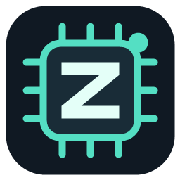
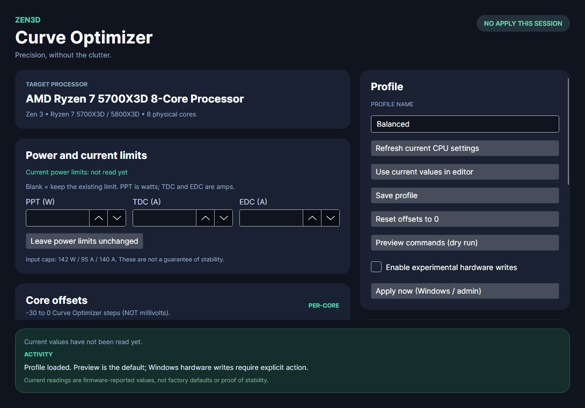
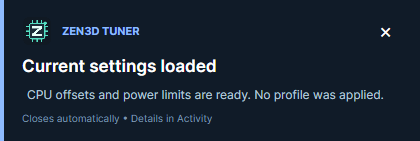

# Zen3D Tuner



**A focused, open-source Curve Optimizer and power-limit tuner for AMD Ryzen 7 5700X3D and 5800X3D.**

[Download the Windows release](https://github.com/Tzesh/Zen3DTuner/releases) · [Changelog](CHANGELOG.md) · [Windows guide](docs/WINDOWS-TESTING.md) · [Contributing](CONTRIBUTING.md)



Zen3D Tuner lets you inspect current firmware settings, adjust per-core Curve Optimizer offsets and power limits, save a profile, and optionally apply that profile automatically. The interface is built with Avalonia and .NET 10. Hardware access uses PawnIO through the vendored ZenStates-Core library.

## What it does

- Reads eight current CO offsets and PPT/TDC/EDC limits automatically when the Windows app opens, with UAC approval when required.
- Shows current CPU readings separately from the settings you are editing. Unknown values remain unavailable.
- Copies supported current settings into the editor; on first launch without a saved profile, complete supported readings initialize the editor automatically.
- Saves a named local JSON profile without changing the CPU. Manual Apply uses the visible settings without overwriting your saved profile.
- Previews commands before application and reports firmware acknowledgements and failures in Activity.
- Optionally applies your saved profile each time the app opens and shows a desktop toast.
- Optionally applies a separate tested snapshot 30 seconds after Windows logon, with a desktop toast and no editor window.

## What the settings mean

| Setting | Meaning | Editor range |
| --- | --- | --- |
| Core 0–7 | Curve Optimizer steps; these are **not millivolts** | −30 to 0 |
| PPT | Package power tracking limit | 1–142 W |
| TDC | Sustained current limit | 1–95 A |
| EDC | Peak current limit | 1–140 A |

Blank power fields leave existing limits unchanged. They do not restore defaults. The ranges above are input caps, not recommended settings or a stability guarantee. Negative CO can reduce the requested voltage along the CPU's curve; the outcome depends on the processor, workload, and firmware.

**Current readings are not factory defaults.** BIOS settings or another utility may have already changed them. Refresh to read the firmware again; use **Use current values in editor** to explicitly replace the editor contents. Complete readings outside supported write ranges or with fractional limits are displayed but not silently clamped or imported.

## A real-world 5700X3D example

The maintainer reports the following profile as stable on their own Ryzen 7 5700X3D. Firmware readback on that machine matched these settings. The workload coverage and test duration have not been documented; this is a **user-reported example**, not an independently certified or universally stable preset.

Core numbering matches the app and starts at 0. **Core 6 is -25; Core 7 is -26.**

| Core | CO offset |
| --- | ---: |
| 0 | -15 |
| 1 | -15 |
| 2 | -25 |
| 3 | -25 |
| 4 | -25 |
| 5 | -25 |
| 6 | -25 |
| 7 | -26 |

| PPT | TDC | EDC |
| ---: | ---: | ---: |
| 100 W | 70 A | 100 A |

The [example JSON](examples/tzesh-5700x3d.json) includes these settings with **automatic application disabled**. It is never loaded or applied automatically. Individual CPUs can require different offsets, including among processors with the same model name. Test your own settings before enabling automatic application.

## Desktop notifications

The branded desktop toasts distinguish information, success, warnings, and failures:

- **Current settings loaded** after a complete startup read, when no automatic apply is selected. Partial reads and failures have their own messages.
- **Profile applied** after firmware acknowledges application; readback and stability remain separate results.
- **Profile saved** after local persistence, and feedback when scheduled logon application is enabled or disabled.
- A matching toast after the standalone logon helper finishes, without opening the editor.

Toasts do not activate their window or take keyboard focus. They dismiss after 7 seconds (12 for warnings/errors), pause while hovered, and have a close button. In the editor, a new toast replaces the previous one. Use **Preview desktop notification** to try the appearance without saving or applying settings.

These are Avalonia-rendered desktop toasts, not browser Toastr or Windows Action Center notifications. Details remain in Activity and, for hardware operations, the protected log.



## Get started on Windows

1. Download and extract `Zen3DTuner-v0.4.0-win-x64.zip` from [Releases](https://github.com/Tzesh/Zen3DTuner/releases). Keep the full extracted folder together.
2. Install [PawnIO](https://github.com/namazso/PawnIO) separately using its official installer. No driver installer is bundled or automatically executed.
3. Run `Zen3D.Tuner.exe`. The release includes the .NET runtime. Allow the read-only helper's Windows administrator prompt to load current settings.
4. Review current CO and power limits. Edit your requested settings, give the profile a name, and choose **Save profile**.
5. Use **Preview commands (dry run)** to inspect the request. Enable experimental hardware writes and choose **Apply now** when ready. A toast reports the result.
6. Refresh current settings after application and independently test stability before enabling automatic application.

Requires Windows x64, a supported eight-core CPU, PawnIO, and a Windows administrator account. Same-account UAC consent is supported; switching to a different administrator account is rejected. Firmware compatibility can vary. The 5800X3D is supported by the eligibility checks but has not yet been tested in this project.

The binaries are unsigned. The app does not disable Windows security features or install legacy InpOut/WinRing0 drivers.

To update an existing Program Files installation, close the app and run `.\Update-Windows.ps1 -BuildDirectory .` from the newly extracted release in an administrator PowerShell. The updater keeps the old installation as a backup and preserves your profile and scheduled-task state.

## Automatic application

**When the app opens:** select **Apply saved profile when app opens**, enable hardware writes, confirm that you tested these exact settings, then **Save profile**. Future launches read current settings first and then apply the saved profile, requesting UAC as necessary. Uncheck the option and save to disable it. **Launch GUI at Windows login** can launch this same flow at login.

**At Windows logon without the editor:** install the release into the protected Program Files location using the supplied script, then choose **Save snapshot + enable at logon** after testing and confirming the settings. The task runs once after a 30-second delay and shows a toast. Editing your normal profile does not update this snapshot; enroll again to replace it. **Disable logon application** removes this logon task. It does not change the separate app-open checkbox.

Choose one automatic mode to avoid duplicate application. Neither mode is enabled by downloading, building, or installing the app. There is no wake/resume reapplication, automatic stress test, automatic retry after a failed apply, or rollback of partial writes.

## Readback and validation status

Version 0.3.0 passed a Windows Release build, core smoke tests, and headless UI tests. A read-only run on a Ryzen 7 5700X3D returned all eight CO offsets at −5, PPT at 125 W, TDC at 95 A, and EDC at 120 A using PM table `0x380905`. These values are observations, not a preset recommendation.

CO readback preserves raw firmware responses. Power readback accepts explicitly mapped Vermeer tables `0x380904` and `0x380905`; unknown versions are reported as unavailable. See [readback details and mapping provenance](docs/READBACK.md).

Firmware acknowledgement, firmware readback, measured voltage, and system stability are different results. Reboot/logon execution, 5800X3D behavior, and long-term stability have not been verified for this release. Hardware tuning remains experimental. A failed write may leave earlier changes active.

## Build from source

Install the .NET 10 SDK (10.0.400 or newer in a compatible feature band):

```powershell
dotnet restore src/Zen3D.Tuner/Zen3D.Tuner.csproj
dotnet build src/Zen3D.Tuner/Zen3D.Tuner.csproj -c Release
dotnet run --project tests/Zen3D.Tuner.SmokeTests -c Release
dotnet run --project tests/Zen3D.Tuner.UiTests -c Release
dotnet run --project src/Zen3D.Tuner
```

Create a self-contained Windows package:

```powershell
powershell -NoProfile -File tools/Package-Windows.ps1
```

macOS can build/run the profile editor and dry-run tests; hardware operations are Windows-only. CI builds and tests Windows and macOS without touching hardware.

## Command line

```text
Zen3D.Tuner.exe --read-current --no-gui
Zen3D.Tuner.exe --diagnose
Zen3D.Tuner.exe --preview-profile "profile.json" --no-gui
Zen3D.Tuner.exe --apply-profile "profile.json" --no-gui
Zen3D.Tuner.exe --apply-profile "profile.json" --no-gui --notify
Zen3D.Tuner.exe --startup-enable "profile.json" --confirm-stable --no-gui
Zen3D.Tuner.exe --startup-disable --no-gui
```

The Windows executable uses the GUI subsystem, so consult Activity or the protected log if your terminal does not show output. Exit code 0 for a read operation means the routine completed; inspect the snapshot's `Complete` field and errors for actual availability.

## Files and architecture

| Location | Purpose |
| --- | --- |
| `%APPDATA%\Zen3DTuner\profile.json` | Saved editor profile and app-open auto-apply preference |
| `%ProgramData%\Zen3DTuner\stable-<SID>.json` | Protected logon snapshot |
| `%ProgramData%\Zen3DTuner\apply-<SID>.log` | Protected hardware operation log |
| `Zen3DTuner-Apply-<SID>` | Per-user Windows scheduled task |
| `src/Zen3D.Core` | Profiles, validation, telemetry decoding, task definition |
| `src/Zen3D.Hardware` | CPU checks and native PawnIO/SMU operations |
| `src/Zen3D.Tuner` | Avalonia UI, elevation, toast, startup, protected storage |
| `tests` | Hardware-free core and desktop regression tests |
| `third_party/ZenStates-Core` | Vendored source, embedded modules, license, modification notes |

For installation, disabling startup, and recovery, read the [Windows guide](docs/WINDOWS-TESTING.md). See [security boundaries](docs/SECURITY.md) before changing native access or startup behavior.

## License and acknowledgements

Original Zen3D Tuner code is licensed under **GPL-3.0-or-later**; see [LICENSE](LICENSE). ZenStates-Core retains its own GPL-3.0 terms and notices. The vendored source and [local change record](third_party/ZenStates-Core/ZEN3D-CHANGES.md) are included. PawnIO is installed separately. This project is independent and is not affiliated with or endorsed by AMD.


